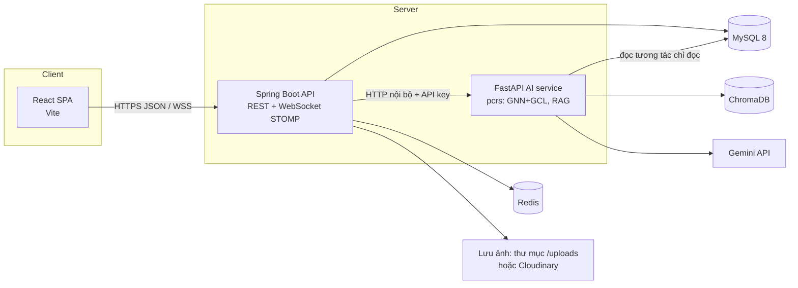
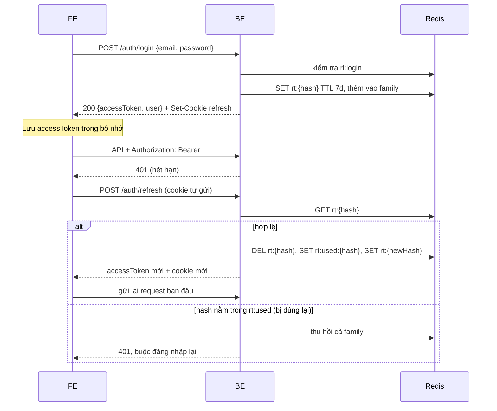
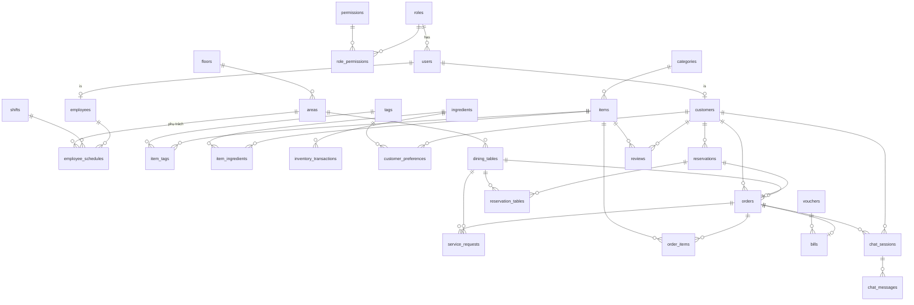

# Thiết kế hệ thống: Nền tảng quản lý nhà hàng tích hợp trợ lý hội thoại AI

Ngày: 08/11/2026 · Nhóm: Nguyễn Đức Bảo, Nguyễn Mạnh Cường · GVHD: TS. Đỗ Thị Liên

> Ký hiệu: **[Đã chốt]** = bạn đã quyết; **[Đề xuất]** = Claude đề xuất, bạn có thể sửa.

---

## 1. Mục tiêu và lý do

Đây là đồ án tốt nghiệp. Hệ thống web quản lý nhà hàng là nơi đưa phần nghiên cứu AI (GNN + GCL + RAG, repo `recommender-system`) vào sử dụng thật: khách trò chuyện với trợ lý, trợ lý gợi ý món theo sở thích cá nhân, và khách gọi món ngay từ gợi ý đó.

**Mục tiêu**
- Có đủ nghiệp vụ nhà hàng: menu, bàn và khu vực, đặt bàn, gọi món, bếp, thanh toán, voucher, kho, nhân viên và ca làm, thống kê.
- Khách quét QR tại bàn để tự gọi món, bếp nhận món theo thời gian thực **[Đã chốt: phương án B]**.
- Chatbot AI có mặt ở trang khách và trang gọi món tại bàn. Gợi ý trả về dưới dạng thẻ món, bấm "Thêm vào giỏ" là xong.
- Xác thực an toàn: access token ngắn hạn, refresh token xoay vòng, TTL rõ ràng cho từng loại dữ liệu tạm.
- Hệ thống tạo ra dữ liệu tương tác thật (đơn, đánh giá, hội thoại) để train lại mô hình gợi ý.

**Ngoài phạm vi (không làm)**
- Cổng thanh toán online (VNPay, MoMo). Chỉ có tiền mặt, chuyển khoản (hiện ảnh VietQR tĩnh) và thẻ, do thu ngân xác nhận.
- Giao hàng, đặt món mang về qua app.
- Nhiều chi nhánh.
- App mobile native. Trang tại bàn là web responsive.
- Đa ngôn ngữ. Chỉ tiếng Việt.
- Gộp bàn, kéo thả sơ đồ bàn tự do (sơ đồ là lưới theo tầng và khu vực; có chuyển bàn).
- Quyền riêng cho từng người ngoài vai trò (Toast có, đồ án chưa cần).
- Tách hóa đơn theo người.

**Những điều không được xảy ra (anti-goals)**
- Ảnh chụp mã QR bàn không được dùng để gọi món từ xa khi bàn chưa mở.
- Token không lưu trong `localStorage`.
- Chatbot không gợi ý món đã hết hoặc món chứa thành phần khách đã khai báo dị ứng.
- Báo cáo không ghi các con số AI chưa chạy thật. Quy tắc này lấy từ `recommender-system/CLAUDE.md`.

---

## 2. Tác nhân và vai trò

| Vai trò | Ai | Truy cập |
|---|---|---|
| `GUEST_TABLE` | Khách quét QR, không cần đăng nhập | `/t/:qrToken`, chỉ thấy đơn của bàn mình |
| `CUSTOMER` | Khách có tài khoản | Trang khách, đặt bàn, lịch sử, điểm, chat |
| `WAITER` | Phục vụ | Sơ đồ bàn, mở bàn, gọi món hộ, nhận "gọi nhân viên" |
| `CASHIER` | Thu ngân | Như WAITER, thêm thanh toán và voucher |
| `CHEF` | Bếp | Màn hình bếp (KDS) |
| `MANAGER` | Quản lý | Toàn bộ trang `/admin` trừ phân quyền |
| `ADMIN` | Quản trị | Tất cả, gồm người dùng, vai trò và quyền |

### 2.0 Cách phân quyền

- Cấu trúc `roles` – `role_permissions` – `permissions` như ERD gốc. Mỗi người dùng có **một** vai trò.
- **Sửa quyền ngay trong từng vai trò**: mở vai trò, thấy một danh sách quyền xếp theo nhóm, bật hoặc tắt từng quyền. **Không dùng ma trận** vai trò × quyền, vì 34 quyền × 7 vai trò khó đọc và dễ bấm nhầm. Cách làm này theo mẫu thường thấy ở các công cụ phân quyền (nhóm thành thẻ, hiện "đã chọn x/y" ở mỗi nhóm, có ô chọn cả nhóm, có ô tìm quyền). Xem mục 7.6.
- 7 vai trò có sẵn (`is_system = true`, không xóa được). ADMIN luôn có tất cả quyền và không sửa được. Người có `role:manage` được **nhân bản** một vai trò rồi sửa để tạo vai trò tùy chỉnh (ví dụ "Trưởng ca", "Thủ kho").
- Quyền có dạng `nhóm:hành_động`. Backend kiểm tra bằng `@PreAuthorize("hasAuthority('bill:pay')")`. Frontend chỉ dùng quyền để ẩn hoặc hiện menu và nút, **không** coi đó là lớp bảo vệ.
- **Menu được tính từ quyền, không từ tên vai trò.** Một trang hiện khi người dùng có ít nhất một quyền mà trang đó yêu cầu (bảng 2.2). Vai trò tùy chỉnh vì vậy tự có menu đúng mà không phải sửa code.
- Khi sửa quyền của một vai trò, các access token còn hạn của vai trò đó bị từ chối (mục 5.3, khóa `role:revoked`), người dùng tự lấy token mới với quyền mới ở request kế tiếp. Không cần đăng xuất.
- `GUEST_TABLE` và quyền phía khách (`chat:use`, đặt bàn của mình, viết đánh giá) cố định trong code, không hiện trong màn hình sửa quyền.

### 2.1 Danh mục quyền (34 quyền, 12 nhóm)

| Nhóm | Mã quyền | Cho phép |
|---|---|---|
| Tổng quan và báo cáo | `dashboard:view` | Xem trang Tổng quan |
| | `report:view` | Xem trang Báo cáo |
| | `report:export` | Xuất báo cáo CSV, Excel |
| Bàn và tầng | `table:view` | Xem sơ đồ bàn |
| | `table:operate` | Mở bàn, chuyển bàn, đổi trạng thái bàn (đang dọn, trống) |
| | `floor:manage` | Thêm, sửa, ngừng dùng tầng, khu vực, bàn; đổi mã QR |
| Đặt bàn | `reservation:view` | Xem danh sách đặt bàn |
| | `reservation:manage` | Xác nhận, từ chối, check-in, đánh dấu no-show, tạo đặt bàn hộ khách |
| Gọi món và phục vụ | `order:view` | Xem đơn đang mở |
| | `order:create` | Gọi món hộ khách, gửi bếp |
| | `order:cancel_item` | Hủy món (chỉ khi bếp chưa nấu) |
| | `service:serve` | Xác nhận "đã mang món ra bàn" |
| | `request:handle` | Nhận và xử lý yêu cầu của khách (gọi nhân viên, tính tiền, xin thêm nước) |
| Thanh toán | `bill:view` | Xem hóa đơn |
| | `bill:pay` | Thu tiền, in hóa đơn |
| | `bill:discount` | Áp voucher, dùng điểm, giảm giá tay |
| | `bill:void` | Hủy hóa đơn đã thanh toán |
| Bếp | `kitchen:view` | Xem màn hình bếp |
| | `kitchen:update` | Đổi trạng thái món, đánh dấu hết món |
| Thực đơn | `menu:view` | Xem thực đơn (chỉ đọc) |
| | `menu:write` | Thêm, sửa món, danh mục, tag, công thức |
| Kho | `inventory:view` | Xem tồn kho |
| | `inventory:write` | Nhập, xuất, điều chỉnh kho |
| Nhân sự | `staff:view` | Xem nhân viên và lịch ca của mọi người |
| | `staff:manage` | Thêm, sửa nhân viên |
| | `schedule:manage` | Xếp ca, gán khu vực phụ trách |
| | `schedule:view_own` | Xem lịch làm của chính mình (mọi nhân viên đều có) |
| Khuyến mãi và khách | `voucher:manage` | Tạo, sửa voucher |
| | `customer:view` | Xem khách hàng, điểm |
| | `review:moderate` | Ẩn đánh giá vi phạm |
| Trợ lý AI | `ai:view` | Xem hội thoại, phản hồi, chỉ số |
| | `ai:manage` | Train lại mô hình, index lại RAG |
| Hệ thống | `user:manage` | Tạo, khóa tài khoản, đổi vai trò của người dùng |
| | `role:manage` | Tạo, sửa vai trò và quyền |

### 2.2 Menu và quyền yêu cầu

Một trang hiện khi người dùng có **ít nhất một** quyền ghi ở cột phải. Quyền khác trong trang quyết định nút nào được bấm (trang chỉ xem thì ẩn nút Thêm, Sửa).

| Nhóm menu | Trang | Quyền yêu cầu |
|---|---|---|
| Vận hành | Tổng quan | `dashboard:view` |
| | Sơ đồ bàn | `table:view` |
| | Gọi món | `order:create` |
| | **Phục vụ** | `service:serve`, `request:handle` |
| | Đặt bàn | `reservation:view` |
| | Hóa đơn | `bill:view` |
| | Màn hình bếp | `kitchen:view` |
| Quản lý | **Báo cáo** | `report:view` |
| | Thực đơn | `menu:view` |
| | Kho nguyên liệu | `inventory:view` |
| | **Tầng và bàn** | `floor:manage` |
| | Nhân viên và ca | `staff:view`, `schedule:manage` |
| | Voucher | `voucher:manage` |
| | Khách và đánh giá | `customer:view`, `review:moderate` |
| | Trợ lý AI | `ai:view` |
| Hệ thống | Người dùng | `user:manage` |
| | **Vai trò và quyền** | `role:manage` |
| Cá nhân | Lịch làm của tôi | `schedule:view_own` |

### 2.3 Quyền mặc định của 7 vai trò

- **WAITER (phục vụ):** `table:view`, `table:operate`, `reservation:view`, `reservation:manage`, `order:view`, `order:create`, `order:cancel_item`, `service:serve`, `request:handle`, `menu:view`, `schedule:view_own`. Menu: Sơ đồ bàn, Gọi món, **Phục vụ**, Đặt bàn, Thực đơn (chỉ xem), Lịch làm của tôi.
- **CASHIER (thu ngân):** như WAITER, thêm `bill:view`, `bill:pay`, `bill:discount`. Menu thêm **Hóa đơn**.
- **CHEF (bếp):** `kitchen:view`, `kitchen:update`, `inventory:view`, `menu:view`, `schedule:view_own`. Menu: Màn hình bếp, Kho (chỉ xem), Thực đơn (chỉ xem), Lịch làm của tôi.
- **MANAGER (quản lý):** tất cả trừ `user:manage` và `role:manage`.
- **ADMIN (quản trị):** tất cả 34 quyền, không sửa được.
- **CUSTOMER** và **GUEST_TABLE:** không có quyền nhân viên (xem 2.0).

---

## 3. Kiến trúc tổng thể **[Đề xuất]**



- **Frontend chỉ gọi Spring Boot.** Không gọi thẳng AI service. Spring Boot xác thực người dùng, ghép thông tin cá nhân (sở thích, dị ứng, lịch sử) rồi gọi AI qua mạng nội bộ với header `X-Internal-Key`. Nhờ vậy AI service không bị lộ ra ngoài và không phải tự làm phần xác thực.
- **Realtime** dùng WebSocket STOMP trên Spring (`/ws`) cho bếp, sơ đồ bàn và trạng thái món của khách. SSE không được chọn vì luồng là hai chiều và cần nhiều topic.
- **Redis** giữ refresh token, OTP, giới hạn tần suất (rate limit), ngữ cảnh chat ngắn hạn và cache menu. Mọi khóa trong Redis đều có TTL.
- **Docker Compose** gồm `mysql`, `redis`, `be`, `ai`, `fe` (nginx phục vụ bản build). Chỉ dùng cho bản demo và lúc bảo vệ.

---

## 4. Công nghệ **[Đề xuất]**

### Frontend (repo này)
| Mục đích | Chọn | Lý do |
|---|---|---|
| Nền | React 19 + Vite + **JSX** (giữ template hiện có) | Đã có sẵn, đúng định hướng ban đầu (React JSX) |
| Router | React Router 8 (`createBrowserRouter`, `lazy` theo từng trang) | Tách bundle: khách tại bàn không phải tải code admin |
| Gọi API, cache | TanStack Query 5 + Axios | Cache, refetch, xử lý chung các trạng thái loading và error |
| State cục bộ | Zustand | Access token (chỉ giữ trong bộ nhớ), giỏ món tại bàn |
| UI | Ant Design 6 (ConfigProvider token, `vi_VN`; hỗ trợ React 19 sẵn, không cần bản vá như antd 5) | Có sẵn Table, Form, DatePicker tiếng Việt cho trang admin. Trang khách tự tùy biến theme |
| Biểu đồ | Recharts | Dashboard doanh thu |
| Realtime | `@stomp/stompjs` | Khớp với STOMP phía Spring |
| Ngày giờ | dayjs (antd đã dùng) | Không thêm thư viện |
| Kiểm thử | Vitest + Testing Library; Playwright cho luồng E2E chính | Đã có skill `playwright-cli` |
| Lint | oxlint (có sẵn) | Giữ nguyên |
| Dữ liệu khi chưa có BE | Lớp API giả `src/shared/api/api.js` lưu vào localStorage, cùng hình dạng với REST ở mục 8 | FE làm trước được. Khi BE xong chỉ thay phần thân các hàm trong `api.js` bằng lời gọi Axios, trang và hook giữ nguyên |
| Icon | **Lucide** (`lucide-react`, giấy phép ISC, hơn 2.000 icon nét đơn) | Chỉ có hình, một màu, vẽ bằng `currentColor` nên đổi màu bằng CSS. Chỉ import icon cần dùng để bundle nhỏ. Không dùng emoji trong giao diện. |

### Backend (`restaurant-manager-be`)
Java 21, Spring Boot 3.5+, Spring Security 6, Spring Data JPA (Hibernate), **Flyway** (quản lý thay đổi schema), MySQL 8, Spring Data Redis, Spring WebSocket (STOMP), Bean Validation, MapStruct, springdoc-openapi (Swagger UI), JJWT (ký JWT), Spring Mail (gửi OTP), WebClient (gọi AI). Lỗi trả theo chuẩn RFC 7807 `ProblemDetail`. Kiểm thử bằng JUnit 5 + Testcontainers (MySQL, Redis).

### AI service (`recommender-system`)
Thêm `service/` dùng FastAPI và tái sử dụng `pcrs/`:
- `POST /recommend` (userId, k, loại trừ, ràng buộc) → top-N món
- `POST /chat` (sessionId, câu hỏi, hồ sơ khách) → câu trả lời + danh sách món gợi ý + đoạn ngữ cảnh đã truy xuất
- `POST /admin/retrain`, `POST /admin/reindex`, `GET /health`

---

## 5. Xác thực, phiên và TTL

### 5.1 Có cần bảng cho token không?
**Không bắt buộc.** **[Đề xuất]** Refresh token lưu trong **Redis có TTL**, không tạo bảng MySQL:
- Token hết hạn thì Redis tự xóa. Không phải viết job dọn bảng.
- Hệ thống đã cần Redis cho OTP, rate limit và chat nên không thêm thành phần mới.
- Điểm yếu: Redis mất dữ liệu thì mọi người bị đăng xuất. Khắc phục bằng cách bật AOF persistence. Muốn giữ lịch sử đăng nhập để kiểm toán thì mới cần thêm bảng `user_session`. Ở đây chưa cần.

### 5.2 Các loại token

| Loại | Dạng | Nơi lưu ở client | Nơi lưu ở server | TTL |
|---|---|---|---|---|
| Access token | JWT HS256: `sub`, `role`, `perms`, `jti`, `iat`, `exp` | **Bộ nhớ** (Zustand). Không dùng localStorage hay sessionStorage | Không lưu, xác thực bằng chữ ký | **15 phút** |
| Refresh token | Chuỗi ngẫu nhiên 256 bit (không phải JWT) | **Cookie HttpOnly, Secure, SameSite=Strict, Path=/api/v1/auth** | Redis lưu `SHA-256(token)` | **7 ngày**; 30 ngày nếu chọn "Ghi nhớ đăng nhập" |
| Guest table token | JWT, `role=GUEST_TABLE`, `orderId`, `tableId` | sessionStorage (chỉ trong tab đó, quyền rất hẹp) | Redis kiểm tra đơn còn mở | **4 giờ**, và hết hiệu lực ngay khi đơn đóng |
| WebSocket | Gửi access token trong header STOMP `CONNECT` | — | Kiểm tra lúc CONNECT và SUBSCRIBE | Theo access token |

### 5.3 Khóa Redis và TTL

| Khóa | Giá trị | TTL | Dùng cho |
|---|---|---|---|
| `rt:{hash}` | `{userId, familyId, ua, ip, createdAt}` | 7 ngày hoặc 30 ngày | Refresh token đang hiệu lực |
| `rt:used:{hash}` | `{familyId, newHash}` | bằng thời gian còn lại của `rt` | Phát hiện token cũ bị dùng lại sau khi đã xoay vòng |
| `rt:family:{familyId}` | Set các hash | như `rt` | Thu hồi cả một "phiên thiết bị" |
| `user:sessions:{userId}` | Set các familyId | như `rt` | "Đăng xuất mọi thiết bị", trang quản lý phiên |
| `user:revoked:{userId}` | timestamp | 15 phút (= TTL access token) | Đổi mật khẩu hoặc khóa tài khoản: từ chối access token có `iat` cũ hơn mốc này |
| `role:revoked:{roleId}` | timestamp | 15 phút | Sửa quyền của một vai trò: access token của vai trò đó có `iat` cũ hơn mốc này bị từ chối, FE tự refresh để lấy quyền mới |
| `bl:{jti}` | `1` | thời gian còn lại của access token | Đăng xuất: vô hiệu ngay access token hiện tại |
| `otp:{purpose}:{email}` | `{hash(code), attempts}` | 5 phút, tối đa 5 lần nhập sai | Xác minh email, quên mật khẩu |
| `otp:cooldown:{email}` | `1` | 60 giây | Chặn gửi lại OTP liên tục |
| `rl:login:{ip}:{email}` | bộ đếm | 15 phút, khóa sau 5 lần sai | Chống dò mật khẩu |
| `rl:chat:{userId or orderId}` | bộ đếm | 60 giây, tối đa 20 câu | Bảo vệ quota Gemini |
| `table:order:{tableId}` | orderId đang mở | không TTL; xóa khi đóng đơn | Biết bàn đang có khách để chặn QR bị dùng từ xa |
| `chat:ctx:{sessionId}` | N lượt gần nhất + tóm tắt | **30 phút, gia hạn sau mỗi tin nhắn** | Ngữ cảnh hội thoại ngắn hạn. Bản đầy đủ lưu MySQL |
| `cache:menu` | JSON menu công khai | 10 phút, xóa khi sửa menu | Giảm truy vấn |
| `rec:{customerId}` | top-N món | 1 giờ, xóa khi có đơn mới | Cache gợi ý |

### 5.4 Luồng đăng nhập và làm mới token



Các quy tắc đi kèm:
1. **Xoay vòng refresh token.** Mỗi lần refresh, token cũ bị hủy. Nếu token cũ xuất hiện lại sau khoảng ân hạn thì coi là bị đánh cắp và thu hồi cả family.
2. **Khoảng ân hạn 20 giây.** Trong 20 giây sau khi xoay vòng, nếu token cũ được gửi lại thì server trả lại đúng cặp token mới, không thu hồi. Trường hợp này xảy ra khi hai tab cùng refresh hoặc mạng chập chờn.
3. **Phía FE chỉ refresh một lần tại một thời điểm.**
   - Interceptor của Axios giữ một Promise refresh dùng chung. Các request bị 401 cùng lúc thì chờ Promise đó rồi gửi lại.
   - Giữa các tab, dùng `navigator.locks.request('auth-refresh')` để chỉ một tab gọi refresh.
   - `BroadcastChannel('auth')` báo các tab còn lại khi có token mới hoặc khi đăng xuất.
4. **Khi tải trang** (F5), access token trong bộ nhớ mất. App gọi `/auth/refresh` một lần trước khi hiển thị các route cần đăng nhập. Trong lúc đó hiện màn hình chờ.
5. **CSRF.** Chỉ endpoint `/auth/refresh` và `/auth/logout` nhận cookie. Cookie để `SameSite=Strict`, giới hạn `Path`, server kiểm tra header `Origin`. Các API còn lại dùng Bearer header nên không bị CSRF.
6. **Đăng xuất.** Xóa `rt` và family, thêm `bl:{jti}`, xóa cookie. FE xóa store và gửi tin qua BroadcastChannel.
7. **Mật khẩu** băm bằng BCrypt (cost 10–12).

### 5.5 Phiên khách tại bàn (QR)
1. Mỗi bàn có `qr_token` ngẫu nhiên in trên mã QR, dẫn tới `https://host/t/{qr_token}`. Quản lý có thể đổi mã để vô hiệu QR cũ.
2. **Phục vụ phải "mở bàn" trước.** Thao tác này tạo `orders` trạng thái `OPEN` và ghi `table:order:{tableId}`.
3. Khách quét QR, FE gọi `POST /api/v1/table-sessions/join {qrToken}`.
   - Bàn chưa mở: hiện thông báo "Vui lòng gọi nhân viên". Khách vẫn xem được menu.
   - Bàn đã mở: server trả guest token gắn với `orderId`.
4. Khách có tài khoản thì đăng nhập ngay trên trang bàn. Đơn được gắn `customer_id` để tích điểm và cá nhân hóa gợi ý.
5. Khi thanh toán xong, đơn chuyển `COMPLETED`, khóa `table:order` bị xóa. Mọi guest token của đơn đó bị từ chối từ request kế tiếp.

---

## 6. Cơ sở dữ liệu (sửa từ ERD gốc)

### 6.1 Những thay đổi so với ERD gốc và lý do

| ERD gốc | Sửa thành | Lý do |
|---|---|---|
| `user.phone integer` | `VARCHAR(15) UNIQUE` | Integer làm mất số 0 đầu, không chứa được +84 |
| `password`, `email` cho phép NULL | `password_hash NOT NULL`, `email UNIQUE NOT NULL` | Tài khoản phải có thông tin đăng nhập |
| Thời gian kiểu `date` (`create_at`, `order_time`, `reservation_time`, `shift.start_time`…) | `DATETIME` cho thời điểm, `TIME` cho giờ ca | `date` mất giờ phút |
| Tên `create_at`, `word_date`, `item_gredient`, `quntity_need` | `created_at`, `work_date`, `item_ingredient`, `quantity_needed` | Sửa chính tả |
| Bảng tên `table`, `order`, `user` | `dining_table`, `orders`, `users` | Tránh từ khóa SQL |
| `table.reservation_tableid` | Bỏ. `reservation_table(reservation_id, table_id)` là bảng nối đúng | Quan hệ trong ERD gốc bị ngược |
| `area` chỉ có tên và mô tả; `table.capacity` là một con số | `floors` (tầng) → `areas` (khu vực, có loại SẢNH, SÂN THƯỢNG, PHÒNG VIP, QUẦY BAR, kèm phụ thu % và mức chi tối thiểu) → `dining_tables` (`seats`) | Nhà hàng nhiều tầng; phòng VIP có phụ thu và mức chi tối thiểu riêng; đặt bàn, sơ đồ bàn và báo cáo đều theo tầng, khu vực, số chỗ |
| `role` chỉ có tên; `permission` chỉ có tên | `roles.is_system`; `permissions.group_code`, `permissions.label` | Màn hình sửa quyền xếp theo nhóm; chặn xóa vai trò hệ thống |
| Không có | `service_requests` | Phục vụ cần danh sách yêu cầu của khách (gọi nhân viên, tính tiền, xin thêm nước) có người nhận và thời gian xử lý. Cũng đo được chất lượng phục vụ |
| `employee_schedule` chỉ có ca | Thêm `area_id` | Biết phục vụ nào phụ trách khu vực nào trong ca, để lọc "bàn của tôi" |
| `order_item` | Thêm `ready_at`, `served_by`, `served_at` | Đo thời gian từ lúc món xong đến lúc mang ra bàn |
| `order.reservation_tableid` | `orders.table_id` + `orders.reservation_id` (cho phép NULL) | Đơn gắn với bàn và lượt đặt bàn rõ ràng |
| `order_item` thiếu giá | Thêm `unit_price` (giá tại lúc gọi), `status`, `source` | Đổi giá sau này không làm sai hóa đơn cũ. `source` cho biết món được gọi từ menu hay từ gợi ý AI, dùng để đo hiệu quả gợi ý |
| `inventory` tách riêng, quan hệ 1–1 với `ingredient` | Gộp tồn kho vào `ingredient.stock_quantity`, thêm `inventory_transaction` | Cần lịch sử nhập, xuất, trừ kho khi bán |
| `item.tags varchar` | Bảng `tag` + `item_tag` | Đồ thị thuộc tính của mô hình GNN+GCL+Graph cần thuộc tính có cấu trúc. Lọc menu cũng dễ hơn |
| `is_available varchar`, `is_active varchar` | `BOOLEAN` | Đúng kiểu dữ liệu |
| `price integer` | `DECIMAL(12,0)` (VND) | Tiền không dùng kiểu số thực |
| `bill.customer_id` trùng thông tin với `order` | Bỏ, lấy qua `orders.customer_id` | Tránh hai nguồn dữ liệu lệch nhau |
| `order_voucher` (nhiều voucher cho một đơn) | `bill.voucher_id` (mỗi hóa đơn tối đa một voucher) | Nghiệp vụ đơn giản hơn. Muốn nhiều voucher thì thêm lại sau |
| `voucher` thiếu mã và giới hạn | Thêm `code UNIQUE`, `max_discount`, `usage_limit`, `used_count` | Nghiệp vụ voucher thực tế |
| `review` không biết khách đã ăn món chưa | Thêm `order_id`, UNIQUE(`customer_id`,`item_id`,`order_id`) | Chỉ đánh giá món đã gọi, tránh đánh giá ảo |
| Không có | `customer_preference` (thích, không thích, dị ứng theo tag) | Gợi ý cho khách mới chưa có lịch sử. Lọc dị ứng. Đưa vào prompt RAG |
| Không có | `chat_session`, `chat_message` | Lưu lịch sử hội thoại (nguồn dữ liệu cho RAG và báo cáo), lưu món đã gợi ý và đánh giá 👍/👎 |
| Không có | Bảng refresh token | **Không thêm**, dùng Redis (mục 5.1) |

### 6.2 Lược đồ mới



### 6.3 Chi tiết bảng

Mọi khóa chính là `BIGINT AUTO_INCREMENT`, trừ `chat_session.id` dùng `CHAR(36)` UUID để client không đoán được. Các bảng nghiệp vụ có `created_at`, `updated_at` kiểu `DATETIME`.

**Người dùng và phân quyền**
- `roles(id, code UNIQUE, name, description, is_system BOOL)`. 7 vai trò có sẵn có `is_system = true`.
- `permissions(id, code UNIQUE, group_code, label, sort_order)`. 34 quyền ở mục 2.1, nạp bằng Flyway.
- `role_permissions(role_id, permission_id)` PK(role_id, permission_id)
- `users(id, role_id FK, full_name, email UNIQUE, phone UNIQUE, password_hash, avatar_url, status ENUM('ACTIVE','LOCKED'), email_verified BOOL, last_login_at, created_at, updated_at)`
- `customers(user_id PK FK, date_of_birth, gender, loyalty_points INT DEFAULT 0, status)`
- `customer_preferences(customer_id, tag_id, type ENUM('LIKE','DISLIKE','ALLERGY'))` PK(customer_id, tag_id)
- `employees(user_id PK FK, position, hire_date, status ENUM('WORKING','ON_LEAVE','QUIT'))`
- `shifts(id, name, start_time TIME, end_time TIME)`
- `employee_schedules(id, employee_id FK, shift_id FK, area_id FK NULL, work_date DATE, status ENUM('SCHEDULED','PRESENT','ABSENT'))`, UNIQUE(employee_id, shift_id, work_date)

**Menu và kho**
- `categories(id, name, description, sort_order, is_active BOOL)`
- `items(id, category_id FK, name, description, price DECIMAL(12,0), image_url, is_available BOOL, spicy_level TINYINT, prep_minutes SMALLINT, deleted_at NULL)`. Xóa mềm để hóa đơn cũ vẫn tham chiếu được món.
- `tags(id, name, type ENUM('TASTE','INGREDIENT','DIET','OCCASION','CUISINE'))`. Ví dụ: cay, chay, hải sản, có đậu phộng, sinh nhật.
- `item_tags(item_id, tag_id)` PK đôi
- `ingredients(id, name, unit, stock_quantity DECIMAL(12,3), min_stock_level DECIMAL(12,3), cost_per_unit DECIMAL(12,0))`
- `item_ingredients(item_id, ingredient_id, quantity_needed DECIMAL(12,3))` PK đôi
- `inventory_transactions(id, ingredient_id FK, type ENUM('IMPORT','EXPORT','ADJUST','CONSUME'), quantity, unit_cost, note, employee_id FK NULL, order_id FK NULL, created_at)`

**Bàn, đặt bàn, gọi món, thanh toán**
- `floors(id, name, level TINYINT, sort_order, is_active)`. Ví dụ: Tầng 1, Tầng 2, Tầng 3.
- `areas(id, floor_id FK, name, type ENUM('HALL','OUTDOOR','VIP_ROOM','BAR'), service_fee_percent DECIMAL(4,1) DEFAULT 0, min_spend DECIMAL(12,0) DEFAULT 0, is_active)`. Phụ thu và mức chi tối thiểu áp cho cả khu vực (phòng VIP).
- `dining_tables(id, area_id FK, code UNIQUE, seats SMALLINT, status ENUM('AVAILABLE','OCCUPIED','RESERVED','CLEANING','DISABLED'), qr_token CHAR(32) UNIQUE, is_active)`. Giao diện nhóm bàn theo số chỗ 2, 4, 6, 8 trở lên. Bàn đã có đơn thì chỉ ngừng dùng (`is_active = false`), không xóa.
- `reservations(id, customer_id FK NULL, guest_name, guest_phone, reservation_time DATETIME, guest_count, preferred_area_id FK NULL, note, deposit_amount, status ENUM('PENDING','CONFIRMED','SEATED','COMPLETED','CANCELLED','NO_SHOW'), created_at)`
- `reservation_tables(reservation_id, table_id)` PK đôi
- `orders(id, table_id FK NULL, reservation_id FK NULL, customer_id FK NULL, opened_by FK employees, type ENUM('DINE_IN','TAKEAWAY'), guest_count, note, status ENUM('OPEN','COMPLETED','CANCELLED'), opened_at, closed_at)`. Mỗi lượt khách ngồi bàn là một đơn. Gọi thêm món chỉ thêm `order_items`.
- `order_items(id, order_id FK, item_id FK, quantity, unit_price, note, status ENUM('PENDING','COOKING','READY','SERVED','CANCELLED'), source ENUM('MENU','CHATBOT','STAFF'), chat_message_id FK NULL, ready_at DATETIME NULL, served_by FK employees NULL, served_at DATETIME NULL, created_at, updated_at)`
- `bills(id, order_id UNIQUE FK, voucher_id FK NULL, subtotal, service_fee_amount, discount_amount, points_used, tax_amount, total_amount, payment_method ENUM('CASH','BANK_TRANSFER','CARD'), status ENUM('UNPAID','PAID','VOID'), cashier_id FK, points_earned, paid_at)`
- `vouchers(id, code UNIQUE, name, type ENUM('PERCENT','FIXED'), value, max_discount, min_order_amount, start_at, end_at, usage_limit, used_count, is_active, created_by FK employees)`

**Yêu cầu của khách**
- `service_requests(id, table_id FK, order_id FK, type ENUM('CALL_STAFF','REQUEST_BILL','EXTRA_WATER','EXTRA_UTENSIL','OTHER'), note, status ENUM('OPEN','ACKNOWLEDGED','DONE'), handled_by FK employees NULL, created_at, acknowledged_at, done_at)`. Khách bấm trên trang tại bàn thì tạo một dòng và phát tới topic `/topic/service`. Mỗi bàn tối đa một yêu cầu cùng loại đang mở, để khách bấm liên tục không làm đầy danh sách.

**Đánh giá và AI**
- `reviews(id, customer_id FK, item_id FK, order_id FK, rating TINYINT 1–5, comment VARCHAR(1000), created_at)`, UNIQUE(customer_id, item_id, order_id)
- `chat_sessions(id CHAR(36), customer_id FK NULL, order_id FK NULL, title, started_at, last_message_at)`
- `chat_messages(id, session_id FK, role ENUM('USER','ASSISTANT'), content TEXT, recommended_item_ids JSON, retrieved_context JSON, latency_ms, feedback TINYINT NULL, created_at)`

**Index chính:** `orders(status, table_id)`, `order_items(status, created_at)` (màn hình bếp), `reservations(reservation_time, status)`, `bills(paid_at)` (thống kê), `service_requests(status, created_at)`, `dining_tables(area_id, seats)`, `chat_messages(session_id, created_at)`.

**Dữ liệu cho AI:** AI service đọc view `v_interactions(customer_id, item_id, weight, ts)`. View này gộp `order_items` của đơn đã thanh toán (trọng số theo số lần gọi) và `reviews` (theo điểm). Đồ thị thuộc tính lấy từ `item_tags` và `item_ingredients`.

---

## 7. Giao diện (các cổng và màn hình)

Có bốn cổng, mỗi cổng có layout riêng và được tải tách (lazy) theo route.

### 7.1 Khách hàng: `/` (responsive, ưu tiên điện thoại)
- Trang chủ: banner, món nổi bật, khối **"Gợi ý cho bạn"** (đã đăng nhập thì gợi ý cá nhân, chưa đăng nhập thì món phổ biến)
- Menu: lọc theo danh mục, tag, tìm kiếm, sắp xếp theo giá. Chi tiết món kèm đánh giá. Dị ứng khai báo một lần ở hồ sơ; khối gợi ý và trợ lý AI tự loại món đó, không cần nút bật tắt trên trang menu.
- Đặt bàn, trên một trang, tóm tắt cố định bên phải:
  1. Một hàng ba ô: **Ngày** (lịch, tối đa 60 ngày), **Giờ đến** (dropdown khung 30 phút từ 10:00 đến 21:00; khung đã qua không hiện, khung không còn đủ chỗ thì mờ kèm "Hết chỗ"), **Số khách** (dropdown).
  2. **Lưới chọn bàn** theo tầng → khu vực, mỗi ô là một bàn kèm số chỗ. Bàn đã có lượt đặt trong khoảng ±2 giờ thì mờ ("Đã đặt"); phòng VIP cần từ 10 khách. Chưa đủ chỗ thì bấm thêm bàn được; đã đủ chỗ mà bấm bàn khác thì đổi bàn.
  3. Họ tên, số điện thoại, ghi chú. Khi chọn phòng VIP, phần tóm tắt hiện thêm phụ thu và mức chi tối thiểu (hai dòng số, không câu giải thích).
  Sau giờ nhận khách cuối trong ngày, trang mặc định sang ngày mai. Xem và hủy lượt đặt ở trang Tài khoản.
- Đăng nhập, đăng ký (OTP email), quên mật khẩu (OTP)
- Tài khoản: hồ sơ, **sở thích và dị ứng**, lịch sử đơn, điểm tích lũy, viết đánh giá món đã ăn, quản lý phiên đăng nhập (đăng xuất thiết bị khác)
- **Chat widget** (nút nổi): trả lời dạng thẻ món, có 👍/👎 cho từng câu trả lời

### 7.2 Tại bàn: `/t/:qrToken` (chỉ thiết kế cho điện thoại)
```
┌──────────────────────────┐
│ Bàn A05 · Khu sân vườn   │
│ [Tìm món…]        [🛒 3] │
│ Khai vị | Món chính | …  │
│ ┌────┐ Gỏi cuốn  45.000  │
│ └────┘            [ + ]  │
│ …                        │
│ [Gọi NV] [Thanh toán] 💬 │
└──────────────────────────┘
```
- Menu, giỏ món, ghi chú cho từng món, nút "Gửi bếp"
- Theo dõi trạng thái từng món theo thời gian thực: Chờ → Đang nấu → Xong → Đã phục vụ
- "Gọi nhân viên", "Yêu cầu thanh toán", "Xin thêm nước, bát đũa": mỗi nút tạo một dòng `service_requests` và hiện ngay ở trang **Phục vụ**. Khách thấy trạng thái "Nhân viên đã nhận".
- Chatbot: "Gợi ý món cho 4 người, có trẻ em, không ăn cay". Bấm thẻ món là thêm vào giỏ, món được lưu với `source=CHATBOT`.

### 7.3 Giao diện nhân viên: `/staff`

Một giao diện chung cho mọi nhân viên, **menu thay đổi theo quyền** (bảng 2.2). Khung gồm thanh trên (chuông thông báo, tên và vai trò, đăng xuất) và menu trái chia 4 nhóm: Vận hành, Quản lý, Hệ thống, Cá nhân. Route được chặn bằng `RequirePermission`; vào trang không có quyền thì hiện 403.

**Vận hành**
- **Sơ đồ bàn.** Tab theo **tầng** (Tầng 1, 2, 3), trong mỗi tầng nhóm theo **khu vực** (sảnh, sân thượng, phòng VIP). Bộ lọc: số chỗ (2, 4, 6, 8 trở lên), trạng thái, ô tìm bàn; đầu tầng có tóm tắt "Trống 5/12". Ô bàn hiện mã, số chỗ, trạng thái, thời gian ngồi; có chấm báo khi bàn có yêu cầu mới. Phòng VIP hiện thêm mức chi tối thiểu và phụ thu. Bấm bàn mở ngăn kéo: đơn đang mở, mã QR, các nút theo quyền (mở bàn, gọi thêm món, chuyển bàn, thanh toán).
- **Gọi món.** Chọn bàn (nhóm theo tầng), loại đơn (tại bàn, mang đi), danh mục kèm số món, ghi chú theo từng món, nút Gửi bếp.
- **Phục vụ** *(mới, cho phục vụ)*. Hai cột:
  - *Món sẵn sàng mang ra*: món bếp đã nấu xong, xếp theo thời gian chờ lâu nhất lên trên, nút "Đã mang ra" (ghi `served_by`, `served_at`).
  - *Yêu cầu của khách*: gọi nhân viên, tính tiền, xin thêm nước, bát đũa. Trạng thái Mới → Đã nhận → Xong, hiện người đã nhận để hai người không cùng chạy ra một bàn.
  - Công tắc "Chỉ khu vực của tôi" lọc theo `employee_schedules.area_id` của ca hiện tại. Có âm báo khi có yêu cầu mới.
- **Đặt bàn.** Danh sách hôm nay và sắp tới, lọc theo tầng và khu vực. Hệ thống gợi ý bàn theo số khách và số chỗ (chọn bàn nhỏ nhất đủ chỗ). Nút: xác nhận, từ chối, check-in (mở bàn), no-show.
- **Hóa đơn.** Hai tab: *Chưa thanh toán* (đơn đang mở, nút Thanh toán) và *Lịch sử hóa đơn* (lọc ở 7.10). Khi thanh toán: hiện tạm tính, phụ thu khu vực, voucher, điểm, VAT. Với phòng VIP, nếu tổng chi thấp hơn mức tối thiểu thì hóa đơn tự bù phần chênh và ghi rõ dòng "Bù mức chi tối thiểu". Chọn phương thức, in hóa đơn.
- **Màn hình bếp.** Ba cột Chờ, Đang nấu, Xong. Món xong tự chuyển sang danh sách "Món sẵn sàng mang ra" của phục vụ.

**Quản lý**
- **Thực đơn**, **Kho nguyên liệu**: người chỉ có quyền xem (ví dụ bếp, phục vụ) thấy bảng nhưng không có nút Thêm, Sửa.
- **Tầng và bàn** *(mới, mục 7.4)*.
- **Báo cáo** *(mới, mục 7.5)*. Tách khỏi Tổng quan: Tổng quan là vài con số xem nhanh, Báo cáo là phân tích theo kỳ có lọc và xuất file.
- **Nhân viên và ca**: lịch tuần, gán ca và khu vực phụ trách.
- **Voucher**, **Khách và đánh giá**, **Trợ lý AI**.

**Hệ thống**: **Người dùng** (tài khoản, chọn vai trò, khóa) và **Vai trò và quyền** (mục 7.6).

**Cá nhân**: **Lịch làm của tôi**. Mọi nhân viên xem được ca tuần này, khu vực phụ trách và ca tuần sau.

### 7.4 Quản lý tầng và bàn: `floor:manage`

- Cột trái là cây **tầng → khu vực**; cột phải là bảng bàn của khu vực đang chọn (mã bàn, số chỗ, trạng thái, mã QR).
- Tạo **khu vực** với loại (sảnh, sân thượng, phòng VIP, quầy bar). Phòng VIP nhập thêm phụ thu % và mức chi tối thiểu.
- **Thêm bàn hàng loạt**: nhập tiền tố, số lượng, số chỗ (ví dụ `A`, 6 bàn, 4 chỗ → A01..A06). Đổi mã QR bàn, tạm khóa bàn.
- Bàn đã có đơn thì chỉ ngừng dùng, không xóa.
- Ví dụ dữ liệu mẫu: Tầng 1 (Sảnh: 10 bàn 2 và 4 chỗ); Tầng 2 (Sảnh: bàn 4, 6, 8 chỗ; Sân thượng: bàn 4 chỗ); Tầng 3 (Phòng VIP 1 12 chỗ, VIP 2 16 chỗ, VIP 3 20 chỗ).

### 7.5 Báo cáo và thống kê: `report:view`

Bộ lọc dùng chung: khoảng thời gian (hôm nay, 7 ngày, tháng này, tùy chọn), so sánh với kỳ trước, tầng và khu vực. Mỗi biểu đồ có bảng số liệu đi kèm. Xuất CSV hoặc Excel cần `report:export`.

| Tab | Nội dung |
|---|---|
| Doanh thu | Tổng doanh thu, số đơn, giá trị trung bình mỗi đơn; doanh thu theo ngày; theo giờ trong ngày; theo phương thức thanh toán; theo tầng và khu vực; tổng giảm giá và phụ thu |
| Món ăn | Bán chạy, bán chậm; theo danh mục; tỉ lệ hủy món; số món được gọi từ gợi ý AI |
| Bàn và đặt bàn | Tỉ lệ lấp bàn theo giờ; số lượt khách mỗi bàn trong ngày (vòng quay bàn); thời gian ngồi trung bình; tỉ lệ no-show; theo tầng, khu vực, phòng VIP |
| Nhân viên | Số đơn và doanh thu mỗi người; thời gian từ lúc món xong đến lúc mang ra; thời gian nhận yêu cầu của khách |
| Kho | Nguyên liệu tiêu hao; chênh lệch giữa lý thuyết (theo công thức) và thực tế (phiếu điều chỉnh); giá vốn; lãi gộp |
| Khách hàng | Khách mới và quay lại; theo hạng; điểm đã cấp và đã dùng |
| Trợ lý AI | Số hội thoại; tỉ lệ phản hồi hữu ích; tỉ lệ món gợi ý được thêm vào giỏ; doanh thu từ món gợi ý; độ trễ trung vị và p95 |

Về kỹ thuật: tính bằng truy vấn tổng hợp theo ngày trên `bills`, `order_items` (có index ở 6.3). Nếu chậm khi dữ liệu lớn thì thêm bảng tổng hợp theo ngày, cập nhật bằng job đêm. Đồ án chưa cần.

### 7.6 Người dùng, vai trò và quyền

**Vai trò và quyền** (`role:manage`), bố cục hai cột:
- Cột trái: danh sách vai trò, mỗi dòng có số người dùng. Nút "Thêm vai trò" (nhân bản từ vai trò có sẵn).
- Cột phải: tên, mô tả; ô tìm quyền; các **thẻ nhóm quyền** (12 nhóm ở 2.1). Mỗi thẻ có ô chọn cả nhóm (hiện trạng thái "một phần" khi chỉ bật một số quyền), số quyền đã chọn "3/5", nút thu gọn, và từng quyền là một công tắc kèm mô tả một dòng.
- Thanh lưu cố định cuối trang, hiện khi có thay đổi chưa lưu ("Đã sửa 3 quyền", nút Hủy và Lưu). Dòng nhắc: quyền mới có hiệu lực ở request kế tiếp của người dùng.
- ADMIN: mọi công tắc bật và khóa. Vai trò hệ thống không xóa được.
- Có phần "Menu người này sẽ thấy" xem trước, để người sửa biết ngay việc bật quyền làm hiện thêm trang nào.

**Người dùng** (`user:manage`): bảng tài khoản, đổi vai trò bằng danh sách chọn, khóa và mở khóa (khóa thì thu hồi mọi phiên đăng nhập, mục 5.3).

### 7.7 Quy tắc giao diện chung

- **Icon:** Lucide, một bộ duy nhất, nét đơn, kích thước 20px ở menu và 16px trong nút, độ dày nét cố định. Icon tô bằng màu chữ hiện tại (`currentColor`): màu xám nâu mặc định, đậm hơn khi di chuột, cam khi trang đang chọn. Không dùng emoji và không tô nhiều màu cho icon.
- **Màu:** nền trắng và các tông kem, cam nhạt; điểm nhấn cam (chữ và nút dùng tông cam đậm để đủ tương phản trên nền trắng). Màu trạng thái (xanh, vàng, đỏ) chỉ dùng cho huy hiệu và luôn kèm chữ, không chỉ dựa vào màu.
- Mọi nút, liên kết, thẻ bấm được có trạng thái di chuột, nhấn và focus nhìn thấy rõ.
- **Khung nhân viên:** không có thanh trên; thanh trái nền ấm gồm logo, menu, tài khoản ở đáy. Nội dung trên nền trắng, bảng chỉ có đường kẻ ngang mảnh, viền trung tính; cam chỉ dành cho nút chính và mục đang chọn. Con số tổng quan xếp thành một hàng, không đóng khung từng ô. Bàn phân biệt trạng thái bằng nền nhạt và chữ.
- **Trang khách:** ảnh thật dẫn dắt (ảnh toàn khổ ở đầu trang chủ, ảnh món vuông), tiêu đề chữ có chân Lora, thực đơn là danh sách theo danh mục.

### 7.8 Topic realtime (STOMP)
| Topic | Bên nghe | Sự kiện |
|---|---|---|
| `/topic/kitchen` | Bếp | Món mới, món bị hủy |
| `/topic/tables` | Phục vụ, thu ngân | Trạng thái bàn đổi |
| `/topic/service` | Phục vụ | Yêu cầu mới của khách, món vừa xong cần mang ra |
| `/topic/orders/{orderId}` | Khách tại bàn | Trạng thái món, đơn đã đóng |
| `/user/queue/notify` | Từng người | Đặt bàn được xác nhận… |

Server kiểm tra quyền khi client SUBSCRIBE. Guest token chỉ được nghe `/topic/orders/{orderId của mình}`.

### 7.9 Cấu trúc thư mục FE (đã dựng)
```
src/
  app/            router.jsx (lazy từng trang), providers.jsx (antd theme, QueryClient)
  layouts/        StaffLayout (menu theo quyền, RequirePermission), CustomerLayout
  shared/
    api/          api.js (API giả, sau thay bằng Axios), hooks.js (useCol, useRun)
    auth/         permissions.js (34 quyền, menu), authStore.js (Zustand)
    components/   TablePicker + TimeSelect, FormModal + useCrud, ChartCard, Rows, ui.jsx
    mock/         seed.js (dữ liệu mẫu 60 ngày)
    utils/        billing.js (+ test), booking.js, format.js
  features/       dashboard, tables, pos, service, reservations, billing, kitchen, reports,
                  menu, inventory, floors, staff, vouchers, customers, ai, users, roles,
                  my-schedule, customer (trang chủ, menu, đặt bàn, tài khoản), table-order, chat, auth
```
Mỗi trang lấy dữ liệu qua `useCol('tên_bảng')` và ghi qua `useRun()(() => api.x(...), 'thông báo')`. Hai hook này là chỗ duy nhất phải đổi khi nối backend.

### 7.10 Danh sách quản lý: thao tác và bộ lọc

Mọi trang danh sách có cùng khung: tiêu đề và nút **Thêm** ở trên; thanh lọc (ô tìm không dấu, các bộ lọc, nút "Xóa lọc"); bảng có sắp xếp cột, phân trang, đếm tổng; cuối mỗi dòng có nút **Sửa** và **Xóa** (xóa phải xác nhận). Người chỉ có quyền xem thì không thấy Thêm, Sửa, Xóa. Thêm và sửa dùng chung một modal form có kiểm tra dữ liệu (bắt buộc, email, số điện thoại 10 số, mã không trùng).

| Trang | Thêm, sửa, xóa | Bộ lọc |
|---|---|---|
| Thực đơn · Món | Có. Xóa mềm (hóa đơn cũ vẫn giữ món). Bật tắt "còn món" ngay trên bảng. Form có công thức (nguyên liệu, định lượng) | Tên; danh mục (chọn nhiều); tag; khoảng giá; còn hoặc hết món |
| Thực đơn · Danh mục | Có. Không xóa được khi còn món | Tên |
| Thực đơn · Tag | Có. Xóa thì gỡ khỏi các món | Tên; loại tag |
| Kho · Nguyên liệu | Có. Không xóa khi đang nằm trong công thức | Tên; dưới mức tối thiểu; đơn vị |
| Kho · Phiếu nhập, xuất | Thêm (nhập, xuất, điều chỉnh). Không sửa, không xóa: sai thì lập phiếu điều chỉnh | **Khoảng ngày**; loại phiếu; nguyên liệu |
| Tầng và bàn | Tầng, khu vực, bàn đều có thêm, sửa, xóa; thêm bàn hàng loạt; đổi mã QR. Không xóa tầng còn khu vực, khu vực còn bàn, bàn đã có đơn (chỉ ngừng dùng) | Mã bàn; số chỗ; trạng thái |
| Nhân viên | Có. Không xóa người đã có dữ liệu (chuyển "Đã nghỉ việc") | Tên, email, điện thoại; **vai trò** (chọn nhiều); chức vụ; tình trạng |
| Lịch ca | Bấm ô trống để thêm ca, bấm ca để sửa hoặc xóa; chặn trùng ca trong ngày | Tuần (lùi, tiến, chọn tuần); vai trò; tên |
| Ca làm | Có. Không xóa ca đang có lịch | |
| Đặt bàn | Thêm hộ khách (cùng dropdown giờ và lưới bàn như phía khách), sửa khi chưa nhận bàn; đổi trạng thái qua menu dòng (xác nhận, nhận bàn, không đến, hủy) | Tên, điện thoại; **khoảng ngày** (hôm nay, 7 ngày tới, 7 ngày qua); trạng thái; tầng |
| Hóa đơn | Thanh toán đơn đang mở; hủy hóa đơn đã thu (`bill:void`). Không sửa hóa đơn | Mã, bàn; **khoảng ngày** (hôm nay, 7 ngày, tháng này, tháng trước); phương thức; trạng thái; thu ngân. Dòng tổng doanh thu theo bộ lọc |
| Voucher | Có. Không xóa voucher đã dùng (chỉ tắt) | Mã, tên; trạng thái (đang chạy, sắp chạy, hết hạn, hết lượt, đã tắt); loại; khoảng hiệu lực |
| Khách hàng | Chỉ xem (khách tự đăng ký; khóa tài khoản ở trang Người dùng). Bấm dòng xem lịch sử ăn | Tên, điện thoại, email; hạng; trạng thái tài khoản; khoảng ngày đăng ký |
| Đánh giá | Ẩn, hiện, xóa | Nội dung, tên khách; số sao; món; đang hiện hoặc đã ẩn; khoảng ngày |
| Trợ lý AI | Train lại, index lại RAG (`ai:manage`) | Câu hỏi, tên khách; khoảng ngày; phản hồi; có thêm vào giỏ |
| Người dùng | Có; khóa, mở khóa; gửi email đặt lại mật khẩu. Không xóa tài khoản đã có dữ liệu | Tên, email, điện thoại; **vai trò** (chọn nhiều); trạng thái |
| Vai trò | Thêm bằng nhân bản, sửa tên, mô tả, quyền; xóa vai trò tùy chỉnh không còn người dùng | Ô tìm quyền |
| Báo cáo | Xuất CSV (`report:export`) | **Khoảng ngày** có mốc nhanh; tầng. Mỗi biểu đồ có nút chuyển sang bảng số liệu |

Ràng buộc xóa ở bảng trên được kiểm ở backend (trả 409 kèm lý do), FE chỉ hiện lý do đó.

### 7.11 Chữ trên giao diện

- Nhãn và nút ngắn, là danh từ hoặc động từ: "Thêm món", "Dọn xong", "Đã có người đặt". Không viết câu giải thích quy tắc lên màn hình (ví dụ không ghi "Phòng VIP: phụ thu 10%, chi tối thiểu..., phần chênh được bù vào hóa đơn"). Quy tắc thể hiện bằng con số ở chỗ cần (tóm tắt đặt bàn, hóa đơn) hoặc bằng trạng thái mờ kèm lý do hai, ba chữ.
- Không có công tắc cho việc hệ thống tự làm được (ví dụ lọc dị ứng).
- Trạng thái trống ngắn: "Không có yêu cầu", "Chưa gọi món".

---

## 8. Quy ước API **[Đề xuất]**
- Tiền tố `/api/v1`. Danh từ số nhiều: `/items`, `/orders/{id}/items`.
- Phân trang `?page=0&size=20&sort=createdAt,desc`. Trả về `{content, page, size, totalElements}`.
- Lỗi trả `ProblemDetail` `{type, title, status, detail, errors[]}`. FE hiển thị `detail`, còn `errors[]` hiện cạnh từng ô của form.
- Thời gian theo ISO-8601 với múi giờ `+07:00`. Tiền là số nguyên VND.
- Endpoint auth: `/auth/login`, `/auth/register`, `/auth/verify-email`, `/auth/refresh`, `/auth/logout`, `/auth/logout-all`, `/auth/forgot-password`, `/auth/reset-password`, `/auth/sessions` (GET, DELETE `{familyId}`).
- Hợp đồng API (OpenAPI) viết trước từng phần, FE và BE cùng làm theo.
- Phân quyền: `GET /roles`, `POST /roles` (nhân bản), `PUT /roles/{id}/permissions` (gửi cả danh sách mã quyền), `GET /permissions` (đã nhóm sẵn), `GET /me/permissions`.
- Tầng và bàn: `/floors`, `/areas`, `/tables` (có `POST /tables/bulk`), `POST /tables/{id}/open`, `POST /tables/{id}/move`.
- Phục vụ: `GET /service/ready-items`, `POST /order-items/{id}/serve`, `GET /service-requests?status=OPEN`, `POST /service-requests/{id}/ack`, `POST /service-requests/{id}/done`.
- Báo cáo: `GET /reports/{revenue|items|tables|staff|inventory|customers|ai}?from=&to=&floorId=`, thêm `?format=csv` hoặc `?format=xlsx` để xuất.

---

## 9. Tích hợp AI vào hệ thống thật

1. **Luồng chat:**
   - FE gửi `POST /api/v1/chat/sessions/{id}/messages`.
   - BE kiểm tra rate limit, lấy hồ sơ khách (sở thích, dị ứng, top món đã gọi), danh sách món đang còn bán, rồi gọi AI `/chat`.
   - AI chạy song song hai việc: truy xuất RAG từ ChromaDB (hội thoại cũ, mô tả món) và lấy top-N từ GNN+GCL. Sau đó ghép prompt 5 khối và gọi Gemini.
   - BE lọc lại một lần nữa (bỏ món hết hàng hoặc chứa thành phần dị ứng), lưu `chat_messages`, trả về FE.
2. **Khách mới chưa có lịch sử:** dùng tag sở thích và món phổ biến theo khung giờ. Sau khi khách có từ 3 đơn trở lên thì dùng embedding của mô hình.
3. **Khách mới phát sinh sau lần train:** dùng fold-in đã có trong `pcrs/redial.py` (ghép embedding từ các món khách đã gọi). Không cần train lại mỗi khi có khách mới.
4. **Train lại:** quản lý bấm nút hoặc chạy job hằng đêm. Mô hình mới chỉ được thay vào khi Recall@20 trên tập validation không thấp hơn mô hình đang chạy.
5. **Rủi ro cần nói rõ trong báo cáo:** dữ liệu thật của nhà hàng demo sẽ rất ít. Phần đánh giá học thuật vẫn dùng Food.com và ReDial. Trong hệ thống demo, mô hình train trên dữ liệu đơn hàng sinh giả (seed), và báo cáo ghi rõ đây là dữ liệu giả.
6. **Khi Gemini lỗi hoặc hết quota:** trả top-N gợi ý kèm câu trả lời mẫu, không làm hỏng giao diện.

---

## 10. Kiểm thử và chất lượng
- BE: unit test cho phần tính tiền (voucher, điểm, thuế) và phần xoay vòng token. Integration test bằng Testcontainers.
- FE: Vitest cho interceptor refresh (giả lập 401 đồng thời) và hàm tính giỏ món. Playwright cho ba luồng: đăng nhập và refresh; quét QR → gọi món → bếp nhận → thanh toán; chat → thêm món vào giỏ.
- Bảo mật: kiểm tra theo skill `security-and-hardening`, gồm kiểm tra quyền ở BE cho từng endpoint, upload ảnh (chỉ cho phép jpg, png, webp, tối đa 2MB, đổi tên file), CORS chỉ cho phép origin của FE.

---

## 11. Lộ trình (chi tiết hóa ở bước writing-plans)

| Giai đoạn | Nội dung |
|---|---|
| 0. Thiết kế | Tài liệu này; ERD vẽ lại bằng draw.io cho báo cáo; OpenAPI phần auth và menu. **Đã có:** giao diện React đủ 18 trang nhân viên và 6 trang khách chạy trên API giả (mục 7.9) |
| 1. Nền tảng | BE: project, Flyway V1 schema + dữ liệu mẫu, auth JWT + Redis, RBAC theo danh mục quyền (2.1). FE: router, layout, theme, icon Lucide, Axios + refresh, đăng nhập, menu và route theo quyền, màn hình Vai trò và quyền |
| 2. Menu, tầng, bàn | Admin CRUD danh mục, món, tag; tầng, khu vực, bàn (QR, thêm hàng loạt). Trang menu cho khách |
| 3. Đặt bàn | Khách đặt bàn, quản lý xác nhận, check-in |
| 4. Gọi món realtime | Mở bàn, QR join, giỏ món, màn hình bếp, WebSocket |
| 5. Thanh toán | Hóa đơn, voucher, điểm, in hóa đơn |
| 6. Kho, nhân sự | Nguyên liệu, phiếu kho, trừ kho khi món chuyển sang COOKING; ca và lịch làm |
| 7. AI | FastAPI bọc `pcrs`, view tương tác, chat widget, gợi ý trang chủ, retrain và reindex |
| 8. Báo cáo, đánh giá | Tổng quan, 7 tab báo cáo (7.5), xuất file, review, sở thích khách |
| 9. Hoàn thiện | Docker Compose, E2E, sửa lỗi, dữ liệu demo, kịch bản bảo vệ |

---

## 12. Những phần để người làm tự quyết
Tên class và package; cách tổ chức từng component; màu sắc chi tiết của theme; nội dung dữ liệu mẫu (khoảng 60 món Việt, ảnh lấy từ nguồn được phép dùng).

---

## 13. Rà soát mockup v1 và nguồn tham khảo

**Điểm còn thiếu ở mockup v1 (đã đưa vào các mục trên):** chưa có Báo cáo riêng; icon là emoji nhiều màu; phân quyền dạng ma trận khó đọc; bàn chỉ chia 3 khu vực phẳng, không có tầng, số chỗ, phòng VIP; phục vụ chưa có trang riêng (món sẵn sàng, yêu cầu của khách); chưa có trang quản lý tầng và bàn; chưa có "Lịch làm của tôi"; "Gọi nhân viên" mới chỉ là thông báo, chưa lưu được.

**Tham khảo:**
- Lightspeed Restaurant: Back Office gồm menu, báo cáo, người dùng, sơ đồ sàn; quyền theo từng chức năng và theo nhóm người dùng. https://resto-support.lightspeedhq.com/hc/en-us/articles/115005105873-About-Restaurant-Manager
- Toast: hai lớp quyền (trên máy POS và trên web quản trị), có quyền riêng cho chế độ màn hình bếp. https://intercom.help/toast-central/en/articles/14710653-permissions-reference-guide
- Square for Restaurants: báo cáo theo khu vực sàn và hiệu suất bếp. https://squareup.com/help/us/en/article/6433
- Màn hình sửa vai trò: nhóm quyền thành thẻ, trạng thái "một phần", chọn cả nhóm có thể hoàn tác, ô tìm. https://docs.ninjacat.io/changelog/redesigned-permissions-on-role-edit-screen và https://gitlab.com/gitlab-org/gitlab/-/issues/439480
- Mô hình bàn: mã, số chỗ (có thể là khoảng), khu vực, vị trí; khu vực riêng như phòng riêng và sân. https://docs.molzait.com/docs/guides/floor-plans và https://restaurant-revolution-docs-dev.pages.dev/manager/tables/floor-plan
- Icon: Lucide, giấy phép ISC. https://lucide.dev
- Mẫu giao diện POS trên Dribbble (chọn loại đơn tại bàn, mang đi, giao đi; danh mục kèm số món; ghi chú theo món), tác giả Tajrin Nahar. https://dribbble.com/shots/27870795-Restaurant-Dashboard

**Dự án tham khảo Supply Chain** (https://github.com/trungduck45/Supply_Chain_FrontEnd, https://github.com/trungduck45/Supply-Chain_BackEnd). Học theo: mỗi thực thể có trang danh sách, tạo, sửa, chi tiết; bảng dùng chung có tìm kiếm, sắp xếp, phân trang, xuất Excel; service tách theo nghiệp vụ; route chia theo module. Không theo: token lưu ở localStorage (dự án này giữ access token trong bộ nhớ, refresh token ở cookie HttpOnly); mỗi trang tự viết lại đoạn gọi API, debounce, hủy request (dự án này dùng TanStack Query); dùng cùng lúc MUI, Material Tailwind, Radix và antd (dự án này chỉ dùng antd); backend tách 7 microservice qua RabbitMQ (quá nặng cho một đồ án hai người, dự án này giữ một ứng dụng Spring Boot chia module). Bộ lọc của họ chủ yếu là một ô tìm chung; dự án này thêm bộ lọc theo cột như bảng 7.10.

Không có nguồn nào ở trên nói về phụ thu phòng VIP hay mức chi tối thiểu. Phần này là thiết kế của nhóm, cần xác nhận với nghiệp vụ thật của nhà hàng.
